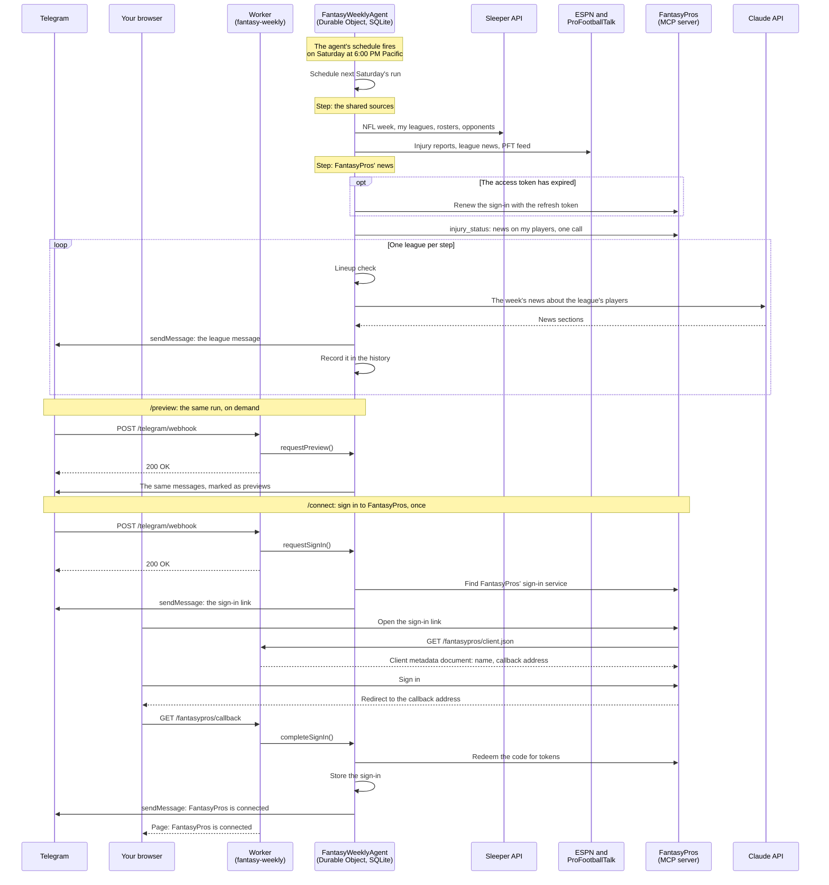

# Fantasy Weekly

An agent that sends a weekly fantasy football digest on Telegram. It runs on Cloudflare, reads rosters from [Sleeper](https://sleeper.com), gathers the week's news about those players from free public sources, and sends one message per league every Saturday at 6:00 PM Pacific: a check of the lineup currently set, followed by the news that affects it.

The full specification is in [issue #1](https://github.com/2myat9/fantasy-weekly/issues/1).

## Status

The digest goes out on its own every Saturday at 6:00 PM Pacific, one message per Sleeper league, and `/preview` sends the same messages on demand, marked as previews. So far each message holds the lineup check: a starter on bye, ruled out or on IR, or an empty starting slot. The rest of the digest is built ticket by ticket on top of this.

- Each run schedules the next one as an instant computed in `America/Los_Angeles`, so the send time holds across both daylight-saving changes. The schedule is armed the first time anything reaches the agent, which after a deploy means the first message sent to the bot.
- The automatic digest is recorded per season, week and league, and a run sends nothing to a league already recorded for its week.
- Each league message the automatic digest sends is kept in the history: its season, week and league, when it was sent, its text as sent, and the source items the writer was handed for it, which are about that league's players and their opponent's. Nothing that was downloaded is kept beyond those items. When the database is over 800 MB after a message is stored, the oldest messages are deleted until it is under.
- The news for a league is what came out since its previous automatic digest, or in the last seven days when it has had none.
- The news on my players comes from ESPN's injury reports and league news, ProFootballTalk's feed, and FantasyPros' news (see [ADR 0001](docs/adr/0001-fantasypros-for-per-player-news.md)). Each run makes one call to FantasyPros' `injury_status` tool, with the names of the players on my rosters as Sleeper writes them; team defenses and opponents' players are not sent. FantasyPros only returns the last 14 days of news, so after more than two weeks without a digest the oldest days of the window have nothing from FantasyPros.
- A player is matched to FantasyPros by name, and FantasyPros' team for them is checked against Sleeper's (FantasyPros writes Jacksonville as `JAC`, Sleeper as `JAX`). A player FantasyPros cannot resolve, or resolves to another team, as it does a name two players share, is unmatched: they get no FantasyPros news and are listed under "Couldn't check". A player with no team in Sleeper is matched without the check. ESPN's reports and news reach a player only through the ESPN ID Sleeper has for them, which is a minority of players; there is no matching to ESPN by name.
- A team defense is covered by ESPN's reports on the absent players of the offense it faces.
- A league gets nothing when the NFL is outside its regular season and postseason, when the league is complete, or when my team is eliminated from its playoffs. A team left with only a placement game, such as the one for third place, counts as eliminated.
- `/preview` works on any day, ignores those rules, and touches neither the record, the history nor the schedule. It considers the same news as the automatic digest would at that moment. It is the fallback if a Saturday digest fails to arrive.
- A failed read of a source, a failed call to FantasyPros and a failed model call are retried. When one keeps failing, the league message is built from what succeeded: it says under its title what is missing, and lists the injury statuses Sleeper has for the roster after the lineup check. The leagues are independent, so one league's failure leaves the other's message as it would have been.
- When the agent is not connected to FantasyPros, or its sign-in has been lost, the league message names FantasyPros' news as missing and says to send `/connect`. Whenever FantasyPros' news is missing, the players Sleeper has no ESPN ID for were looked up nowhere, and are listed under "Couldn't check".
- A run that cannot send a league's message at all, because Sleeper cannot be read or Telegram refuses the message, sends one short failure message naming the league and `/preview`. That league is not written to the sent record.

## How it is built

- One [Agents SDK](https://developers.cloudflare.com/agents/) agent, `FantasyWeeklyAgent`, backed by a single SQLite Durable Object. It owns scheduling, state and history.
- The Worker is named `fantasy-weekly`. Its HTTP surface is three routes and nothing else: the Telegram webhook, `POST /telegram/webhook`; the agent's client metadata document, `GET /fantasypros/client.json`, which FantasyPros reads during a sign-in; and the address FantasyPros sends the browser back to after a sign-in, `GET /fantasypros/callback`.
- The webhook accepts a request only if it carries the webhook secret, and acts on an update only if it comes from the configured chat. It acknowledges Telegram straight away and the agent sends the reply afterwards.
- The commands are `/preview` and `/connect`. Any other message from the configured chat gets a one-line hint naming both.
- `/connect` signs the agent in to [FantasyPros' MCP server](https://api.fantasypros.com/mcp) as your FantasyPros account, so that runs can read player news from it (see [ADR 0001](docs/adr/0001-fantasypros-for-per-player-news.md)). The bot replies with a sign-in link whose client ID is the address of the agent's client metadata document, which names the callback route ([ADR 0003](docs/adr/0003-client-id-metadata-document-for-fantasypros.md)); once you have signed in, FantasyPros sends the browser to the callback route, and the bot replies that FantasyPros is connected, or that the sign-in failed. The callback acts only on the latest sign-in the agent started, and only once. Sending `/connect` again signs in again and replaces the old sign-in when it is completed.
- The sign-in is kept in the agent's storage and renewed with its refresh token when its access token has expired, so scheduled runs call FantasyPros with nobody present. If FantasyPros refuses to renew it, the agent records the sign-in as lost, and `/connect` is needed again. A call to a FantasyPros tool is three requests (the MCP session's setup, then the call), four when the access token has expired, and up to seven when FantasyPros refuses a token that has not. Calls that find the token expired together renew it once. A sign-in link works for 15 minutes. The agent uses a small MCP client of its own rather than the Agents SDK's ([ADR 0002](docs/adr/0002-own-mcp-client-for-fantasypros.md)).
- There is no web interface.
- A run is taken in steps, each its own invocation of the agent, because Cloudflare's free plan allows one invocation 50 outbound requests: Sleeper and the shared news sources first, then the call to FantasyPros (up to seven requests per attempt), then one league message per step. What a run has gathered is kept in the agent's storage in between. The automatic digest and `/preview` go through the same steps.

```
src/
  server.ts          # The agent and the Worker entry point (the webhook)
  digest-time.ts     # When the automatic digest runs: the next Saturday 6:00 PM Pacific
  runs.ts            # The runs in progress and what each has gathered so far
  history.ts         # The digests sent, with their source items, and which leagues each week has gone out to
  retry.ts           # Reading a source again when a read fails
  sleeper.ts         # Sleeper client: NFL week, leagues, rosters, this week's opponents, playoff bracket, player directory
  player-directory.ts # The stored copy of the Sleeper player directory
  fantasypros.ts     # FantasyPros client: the sign-in, its renewal, calls to the MCP server's tools, and its news on a set of players
  espn.ts            # ESPN client: the week's byes and kickoffs, injury reports, league news
  pft.ts             # ProFootballTalk client: the latest entries of its feed
  news.ts            # News gathering: source items about players, from all the news sources
  writer.ts          # The writer: the Claude call that writes the news sections
  writer-material.ts # Which source items the writer is handed for a league
  lineup-check.ts    # The lineup check
  league-message.ts  # Digest composer: the message for one league
  telegram.ts        # Telegram client: sends messages, verifies webhook requests, reads commands
test/
  harness.ts         # The test seam: faked outbound HTTP, a controlled clock, scheduled-run trigger, Telegram update delivery
  fixtures/          # Saved copies of real responses
  sources.ts         # The saved responses a run reads, keyed by URL
  fantasypros.ts     # A stand-in for FantasyPros' sign-in service and MCP server
  connect.test.ts
  digest.test.ts
  news.test.ts
  news-sources.test.ts
  preview.test.ts
  telegram.test.ts
```

How the automatic digest gets to Telegram, and how `/connect` signs the agent in to FantasyPros. The Worker only relays requests to the agent; the agent runs the digest from its own schedule, one step per invocation.



## Setup

These steps are done once, by hand. They need a Cloudflare account and a Telegram account.

### 1. Create the bot

1. In Telegram, open a chat with [@BotFather](https://t.me/BotFather) and send `/newbot`.
2. Give it a name and a username when asked. BotFather replies with the bot token, which looks like `1234567890:AA...`. Keep it private: anyone who has it controls the bot.
3. Optionally send `/setcommands` to BotFather, pick the bot, and send the command list below so the commands appear in the bot's menu:

   ```
   preview - Send the digest as it would be written now
   connect - Sign in to FantasyPros
   ```

### 2. Find your chat ID

Do this before registering the webhook. Telegram does not serve `getUpdates` while a webhook is set.

1. Open a chat with your new bot and send it any message.
2. Fetch the bot's pending updates:

   ```bash
   curl "https://api.telegram.org/bot<BOT_TOKEN>/getUpdates"
   ```

3. Your chat ID is the number at `result[0].message.chat.id`.

### 3. Choose a webhook secret

Any random string of 1 to 256 characters from `A-Z`, `a-z`, `0-9`, `_` and `-`:

```bash
openssl rand -hex 32
```

### 4. Set the secrets

The configuration is five values, all held as Worker secrets:

| Name                      | Value                   |
| ------------------------- | ----------------------- |
| `ANTHROPIC_API_KEY`       | An Anthropic API key    |
| `SLEEPER_USERNAME`        | Your Sleeper username   |
| `TELEGRAM_BOT_TOKEN`      | The token from step 1   |
| `TELEGRAM_CHAT_ID`        | The chat ID from step 2 |
| `TELEGRAM_WEBHOOK_SECRET` | The secret from step 3  |

Set each one on the deployed Worker. Wrangler prompts for the value, so it does not end up in your shell history:

```bash
npx wrangler secret put ANTHROPIC_API_KEY
npx wrangler secret put SLEEPER_USERNAME
npx wrangler secret put TELEGRAM_BOT_TOKEN
npx wrangler secret put TELEGRAM_CHAT_ID
npx wrangler secret put TELEGRAM_WEBHOOK_SECRET
```

For local development, mirror them in `.dev.vars`, which is ignored by git:

```bash
cp .dev.vars.example .dev.vars   # then fill in the values
```

### 5. Deploy and register the webhook

1. Deploy. The output includes the Worker's URL, `https://fantasy-weekly.<your-subdomain>.workers.dev`.

   ```bash
   npm run deploy
   ```

2. Tell Telegram where to deliver updates and which secret to send with them:

   ```bash
   curl "https://api.telegram.org/bot<BOT_TOKEN>/setWebhook" \
     --data-urlencode "url=https://fantasy-weekly.<your-subdomain>.workers.dev/telegram/webhook" \
     --data-urlencode "secret_token=<WEBHOOK_SECRET>" \
     --data-urlencode 'allowed_updates=["message"]'
   ```

3. Send `/preview` to the bot. It replies with one message per league, each marked as a preview. This first message also arms the Saturday schedule: nothing is scheduled until something has reached the agent. If it does not, `curl "https://api.telegram.org/bot<BOT_TOKEN>/getWebhookInfo"` shows the last delivery error, and `npx wrangler tail` shows the Worker's logs.

The webhook only needs registering again if the Worker's URL or the webhook secret changes.

### 6. Connect FantasyPros

1. Send `/connect` to the bot. It replies with a sign-in link.
2. Open the link and sign in with your FantasyPros account. FantasyPros sends the browser back to `https://fantasy-weekly.<your-subdomain>.workers.dev/fantasypros/callback`, which shows whether the sign-in worked.
3. The bot replies "FantasyPros is connected."

This is needed once. Send `/connect` again only if the sign-in is lost (FantasyPros stops renewing it), or to sign in as another account. If the Worker's URL changes, send `/connect` again: the client ID and the callback address are both on the Worker's URL.

## Development

```bash
npm install
npm run dev      # Run the Worker locally
npm test         # Run the tests
npm run check    # Format check, lint and typecheck
npm run types    # Regenerate env.d.ts after changing bindings in wrangler.jsonc
```

## Testing

Tests run with Vitest inside Cloudflare's Workers runtime through [`@cloudflare/vitest-plugin`](https://developers.cloudflare.com/workers/testing/vitest-integration/), so the agent's real Durable Object storage and scheduling are exercised.

There is one test seam, the agent's outside edge. A test fakes what the agent reaches out to, triggers it the way the outside world does, and asserts only on what leaves it. `test/harness.ts` provides:

- `fakeOutboundHttp(savedResponses)`: answers outbound HTTP from saved responses and records the requests made. A request with no saved response fails instead of reaching the network.
- `setClock(instant)`: sets the time the agent reads.
- `triggerScheduledRun(instant)`: runs the agent's scheduled digest run at a chosen instant.
- `pendingSchedule()`: what is on the agent's schedule, to assert on the next scheduled time.
- `deliverTelegramUpdate(update)`: delivers an update to the webhook as Telegram does and waits for the reply work to finish. `textMessage(text, chatId)` builds the update.
- `openInBrowser(address)`: opens an address on the Worker as a browser does, such as the one FantasyPros sends the browser back to after a sign-in. `signInLink(message)` reads the sign-in link out of the bot's reply to `/connect`. `fetchFromWorker(address)` makes a request to the Worker as a server outside does, such as FantasyPros reading the client metadata document.
- `callFantasyPros(tool, args)` and `fantasyProsConnection()`: call a FantasyPros tool as the agent's runs do, and read whether the agent says it is connected.
- `signInToFantasyPros(fantasyPros)`: signs the agent in to a stand-in FantasyPros for a test that is not about the sign-in, without the replies and schedule `/connect` brings.

`test/sources.ts` holds the saved responses of a run, and `fakeSavedSources(sources, { injuryStatus })` serves them with a stand-in FantasyPros the agent is signed in to, whose `injury_status` answers with FantasyPros' saved answer unless the test gives another.

`test/fantasypros.ts` stands in for FantasyPros through `fakeOutboundHttp`: it registers clients, issues codes and tokens, checks PKCE and refresh tokens as the real service does, and answers MCP requests. `signIn(link)` and `decline(link)` stand in for the user at FantasyPros' sign-in page, and `revoke()` for FantasyPros ending the sign-in. A saved response given as a function is called with the request, so a stand-in can answer by what it is sent.

The fake collects the messages sent to Telegram in `telegramMessages`. Tests get stand-in secrets from `vitest.config.ts`, never from `.dev.vars`.

## Known limitations

Left open when over-length league messages were divided ([#14](https://github.com/2myat9/fantasy-weekly/issues/14)), to fix later:

- A single link whose address is itself close to or over Telegram's 4,096-character limit is still sent whole, so Telegram refuses the message and the league is reported as not built. Fitting it would mean dropping or shortening the link.
- An over-length line always begins a new message, so the message before it can go out part-empty instead of being filled first.
- In text with no white space at all, a division can fall between an emoji and its modifier, or between a letter and its combining mark, which then render wrongly. Dividing by grapheme (`Intl.Segmenter`) would avoid it.
- The 4,096-character limit is written out separately in `src/telegram.ts`, `test/harness.ts` and `test/splitting.test.ts`. The fake Telegram also counts the raw HTML, which is stricter than Telegram's own count after the formatting is read.

## Deploy

```bash
npm run deploy
```

Deployment is manual. Nothing is deployed on push.

## License

MIT
